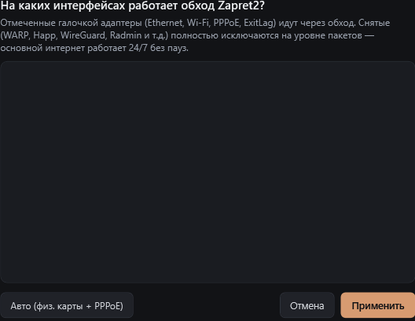

  

<h1 align="center">Zapret2 Kotek</h1>

  Программа для Windows 10 и 11, которая открывает YouTube, Discord, Telegram и нейросети (Gemini, ChatGPT и др.) без VPN. 
  Собрана на базе <a href="https://github.com/bol-van/zapret2">bol-van/zapret2</a> и <a href="https://github.com/Flowseal/zapret-discord-youtube">Flowseal/zapret-discord-youtube</a>.

  <a href="https://github.com/vanch150/zapret2-kotek/releases/latest"><strong>Скачать v1.1.0 (Windows 10 / 11)</strong></a> ·
  <a href="#как-запустить">Как запустить</a> ·
  <a href="#если-что-то-не-работает">Если что-то не работает</a> ·
  <a href="https://github.com/vanch150/zapret2-kotek/releases">Релизы</a> ·
  <a href="LICENSE">MIT</a>

> [!WARNING]
> **Про антивирус и безопасность:** скачивайте программу только из раздела [Releases](https://github.com/vanch150/zapret2-kotek/releases) этого репозитория. Внутри работает официальный сетевой драйвер `WinDivert` из [bol-van/zapret2](https://github.com/bol-van/zapret2) — Windows Defender и антивирусы часто ругаются на него (`HackTool/WinDivert` или `RiskTool`). Это ложное срабатывание; просто добавьте папку программы в исключения антивируса.

## Как запустить

1. Скачайте архив `zapret2-kotek-v1.1.0.zip` со страницы [Releases](https://github.com/vanch150/zapret2-kotek/releases/latest) и распакуйте его в папку с английским названием, например `C:\Zapret2`. Если запустите прямо из «Загрузок», программа сама предложит перенести папку.
2. Запустите `!_START_KOTEK.bat` и нажмите «Да» в окне прав администратора.
3. Нажмите **«Настроить быстро»** и подождите 1–2 минуты. Программа сама подберёт рабочий режим под вашего провайдера и запустит фоновую работу.
4. Если нужен Telegram на компьютере, нажмите **«Подключить»** в строке **Telegram Proxy** — прокси добавится в Telegram Desktop автоматически.

После настройки окно можно закрыть: всё продолжит работать в фоне и будет включаться само после перезагрузки ПК.

## Что есть в программе

- **YouTube, Discord и сайты.** Кнопка **«Настроить быстро»** проверяет основные режимы работы. Если у провайдера жёсткие блокировки, нажмите **«Собрать под себя»** — программа проверит все 22 готовых варианта и соберёт конфиг конкретно под ваш интернет.
- **Telegram на ПК.** Встроенный локальный прокси (`127.0.0.1:1443`) подключается к Telegram Desktop одной кнопкой. В режиме `smart` сначала пробует напрямую, а при блокировке переключается на резервный маршрут.
- **Нейросети («Обход ИИ»).** Открывает доступ к Google Gemini (включая AI Studio и NotebookLM), ChatGPT, Claude (включается только вручную), Copilot, Grok, Perplexity, Cursor / Windsurf и вашим доменам. Обычный интернет, игры и банки при этом не затрагиваются; если включить системный VPN, обход ИИ сам поставится на паузу.
- **Пауза для игр и античитов.** Кнопка **«Пауза»** на Главной полностью останавливает обход и выгружает сетевой драйвер — удобно перед запуском игр со строгими античитами (Vanguard, FACEIT, EAC, BattlEye). Обычные VPN (WireGuard, AmneziaWG, OpenVPN) исключаются автоматически и не конфликтуют с программой.
- **Автообновление и диагностика.** В Настройках можно включить тихое обновление (работает только когда ПК простаивает, проверяет архив по контрольной сумме `SHA256SUMS.txt`) и открыть окно диагностики, если что-то перестало работать.

Другие скриншоты программы

**Вкладка «Стратегии»** — рейтинг проверенных режимов, ручной выбор и добавление своего `.bat`:

**Вкладка «Настройки»** — переключатели, списки сайтов, диагностика, обновления и удаление:

**Свои списки сайтов и исключения VPN:**

<table>
<tr>
<td width="50%"></td>
<td width="50%"></td>
</tr>
</table>

## Важно знать

- **Это не VPN.** Программа не шифрует трафик и не меняет ваш IP. Она снимает блокировки провайдера, но не откроет сайты, которые сами закрыли доступ из вашей страны (исключение — выбранные нейросети в разделе «Обход ИИ»).
- **Режимы могут устаревать.** Если спустя время YouTube или сайт снова перестали грузиться, просто нажмите **«Настроить быстро»** или **«Собрать под себя»** заново.
- **Приватность.** Отправка анонимных отчётов об ошибках выключена по умолчанию и включается только вручную в Настройках (без IP, путей на диске и списков сайтов).

## Если что-то не работает

- **Тормозит YouTube или не грузятся смайлы 7TV в браузере.** Внизу Главной откройте **«Фикс браузера (QUIC / DoH)» → «Параметры»**, включите **«Отключить QUIC (HTTP/3)»** и полностью перезапустите браузер (поддерживаются Chrome, Edge, Яндекс.Браузер, Brave, Vivaldi, Firefox; для Opera показывается подсказка). Если пользуетесь разделом «Обход ИИ», пункт **DoH** оставьте выключенным.
- **Не слышно голос в Discord.** Внизу Главной в блоке **«Голос в Discord и онлайн-игры»** нажмите **«Подобрать»**.
- **Не пускает в онлайн-игру или ругается античит.** Включите **«Игровой фильтр (GameFilter)»** в Настройках. Если мешает сам античит — на время матча нажмите **«Пауза»** на Главной.
- **Не открывается конкретный сайт.** Добавьте его в **Настройки → Свои списки сайтов и исключений** или нажмите **«Собрать под себя»**.

## Обновление и удаление

- **Обновление:** в **Настройках → Обновления Zapret2 Kotek (GitHub) → Проверить**, либо по расписанию в простое ПК. Ваши списки сайтов, настройки и подключение Telegram сохраняются.
- **Полное удаление:** откройте **Настройки → Удалить Zapret2 Kotek из системы** (или запустите `utils\UNINSTALL.bat`). Программа остановит службы, выгрузит драйвер, вернёт настройки браузера и `hosts` как было — после этого папку можно просто удалить.

## Для тех, кто разбирается

Архитектура, консольный режим и структура файлов

- **Движок:** `bin\winws2.exe` из [bol-van/zapret2](https://github.com/bol-van/zapret2) (1.0.7), Lua-скрипты (`lua\`) и ядерные UDP-фильтры `bin\filters\windivert_part.*`. Списки и `.bin`-фейки на базе [Flowseal/zapret-discord-youtube](https://github.com/Flowseal/zapret-discord-youtube) (1.10.4).
- **Консольный режим:** `!_START_KOTEK.bat --cli` (плюс отдельные скрипты `utils\AUTO_SETUP.bat`, `DEEP_OPTIMIZE.bat`, `PAUSE_RESUME.bat`, `UNINSTALL.bat`).
- **Стратегии:** 10 базовых (`strategies\`) и 12 дополнительных (`configs_archive\`), тест по 27 целям + 64-КБ проверка по `speed.cloudflare.com`, синтез `custom_auto_synthesized.bat` (`utils\deep_optimize.ps1`).
- **Telegram WS Proxy:** C# 5 сервис (`utils\TgWsProxyService.cs`, компиляция через `.NET 4.x csc.exe`), служба `zapret-tgws` под `NT AUTHORITY\NetworkService`, слушает только `127.0.0.1:1443`, режимы `smart` / `direct` / `cfonly`, равноправная гонка `ws://:80` и `wss://:443`.
- **Обход ИИ:** `utils\ai_bypass_helper.ps1` создаёт точечные правила Windows NRPT (`Zapret2KotekAI`) через реестр `DnsPolicyConfig` на пул SmartDNS (`lists\ai-dns-pool.txt`), не меняя системный DNS.
- **Автообновление:** `utils\self_update.ps1` проверяет релизы по `SHA256SUMS.txt` (fail-closed) с защитой от Zip-Slip; `utils\autoupdate_task.ps1` регистрирует задачу с `-RunOnlyIfIdle` и выставляет строгие NTFS-права (`icacls`) с сохранением минимальных прав для `NetworkService`.
- **Личные списки (сохраняются при обновлении):** `lists\list-general-user.txt`, `lists\list-exclude-user.txt`, `lists\ipset-exclude-user.txt`, `lists\ai-custom-domains.txt`, `utils\targets.txt`.

## Благодарности и лицензия

Лицензия — [MIT](LICENSE). Подробности по сторонним компонентам — в [THIRD_PARTY_NOTICES.md](THIRD_PARTY_NOTICES.md).

- [bol-van/zapret2](https://github.com/bol-van/zapret2) (MIT) — движок `winws2.exe`, Lua-библиотеки и фильтры.
- [Flowseal/zapret-discord-youtube](https://github.com/Flowseal/zapret-discord-youtube) (MIT) — списки доменов/IPSet, `.bin`-фейки и базовые стратегии.
- [WinDivert](https://github.com/basil00/WinDivert) (LGPLv3 / GPLv2) — драйвер пакетной фильтрации для Windows.
