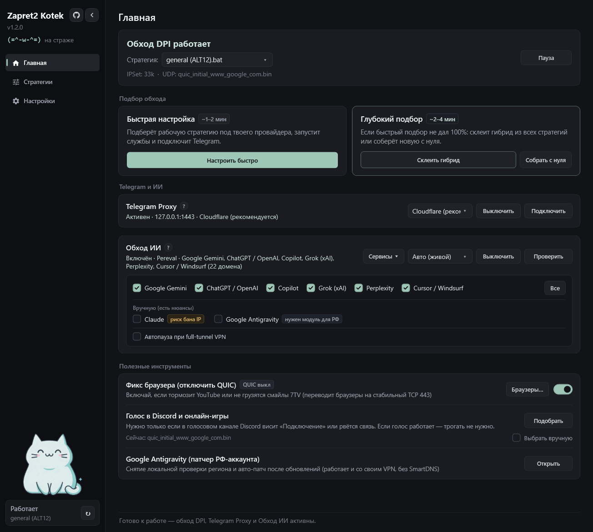
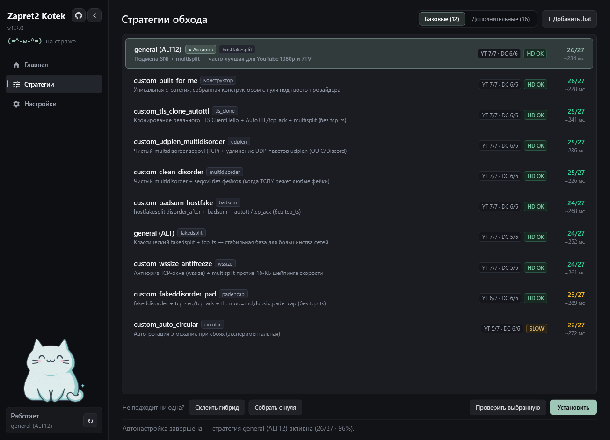
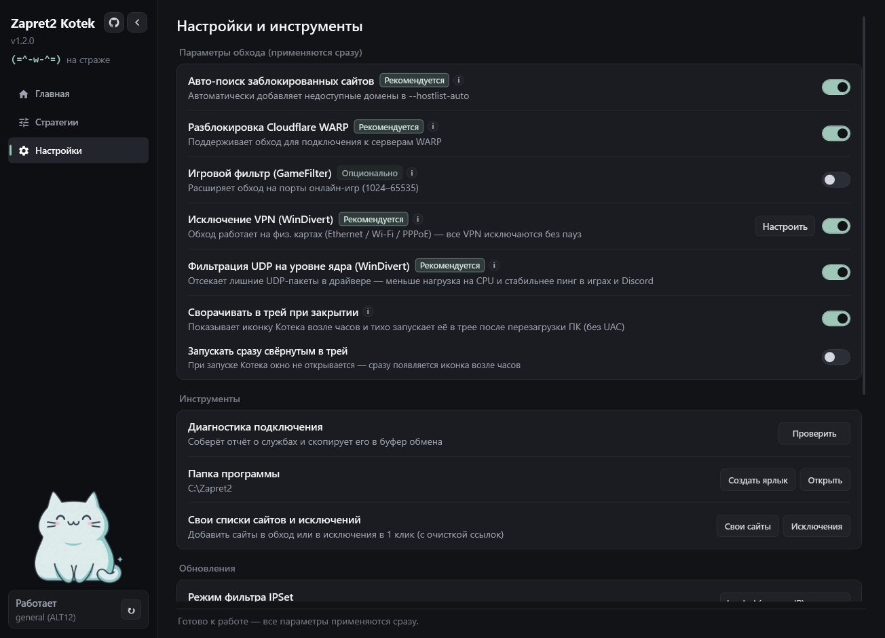
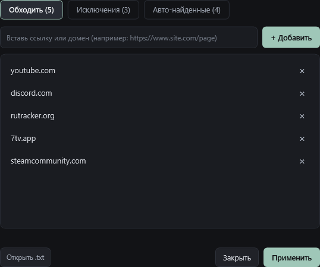
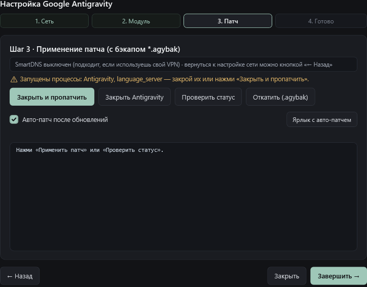

  

<h1 align="center">Zapret2 Kotek</h1>

  Настольная сборка <a href="https://github.com/bol-van/zapret2">zapret2</a> для Windows с нормальным интерфейсом, автоподбором стратегий, локальным Telegram-прокси и доступом к ИИ-сервисам.

  <a href="https://github.com/vanch150/zapret2-kotek/releases/latest"><strong>Скачать v1.2.0</strong></a> ·
  <a href="https://github.com/vanch150/zapret2-kotek/releases">Все релизы</a> ·
  <a href="#зачем-этот-проект">О проекте</a> ·
  <a href="#быстрый-старт">Установка</a> ·
  <a href="LICENSE">MIT</a>

## Зачем этот проект

Сам по себе [zapret2](https://github.com/bol-van/zapret2) — отличный инструмент, но в базовом виде это консольная утилита и десятки `.bat`-файлов, которые нужно перебирать вручную, а потом ещё отдельно разбираться с Telegram, нейросетями, сломанным YouTube в браузере и конфликтами с VPN или античитами.

**Zapret2 Kotek** делался как сборка «поставил и забыл» для обычных домашних ПК на Windows 10/11: без возни в терминале, но с открытым кодом и возможностью тонко всё настроить, если нужно.

## Чем отличается от обычных батников

- **Автоматический подбор и 5-минутный Конструктор вместо ручного перебора.** Программа сама тестирует 12 активных нативных стратегий `zapret2` (+ 16 в архиве) на вашем интернете (YouTube, Discord, 7TV, Cloudflare) и выбирает рабочую. Для сложных провайдеров есть пошаговый 5-минутный «Конструктор с нуля», который собирает персональный конфиг, а также синтез гибридной стратегии из лучших вариантов.
- **Telegram и нейросети без сторонних VPN.** Внутрь встроен собственный локальный MTProto-прокси для Telegram Desktop (написан на C#, работает только на `127.0.0.1`) и бесшовный «Обход ИИ» для нейросетей (Gemini, ChatGPT, Claude, Copilot, Grok, Perplexity, Cursor / Windsurf, а также Google Antigravity с упрощённым мастером, авто-репатчем после обновлений IDE и подключаемым [модулем для РФ-аккаунтов](https://github.com/vanch150/kotek-antigravity-helper)). Работает параллельно со split-tunnel VPN, не ломает системный DNS и оставляет банки и игры напрямую.
- **Уживается с играми и VPN.** Популярные VPN-клиенты (WARP, Happ, WireGuard, AmneziaWG, OpenVPN) исключаются на уровне сетевых интерфейсов (WinDivert) и работают параллельно с обходом без пауз. Если нужно зайти в игру со строгим античитом (Vanguard, FACEIT, EAC, BattlEye), обход можно полностью выгрузить вместе с драйвером в один клик, а потом так же вернуть.
- **Всё открыто и проверяется.** Движок `winws2.exe` и драйвер `WinDivert` взяты напрямую из [bol-van/zapret2](https://github.com/bol-van/zapret2), списки и фейки — на базе [Flowseal/zapret-discord-youtube](https://github.com/Flowseal/zapret-discord-youtube). Обновления выходят только здесь и проверяются по контрольным суммам `SHA256SUMS.txt`.

> [!WARNING]
> **Про антивирус:** Windows Defender и антивирусы часто отмечают подписанный драйвер `WinDivert` как `HackTool/WinDivert` или `RiskTool`. Это стандартное ложное срабатывание для всех сборок на базе `zapret`. Скачивайте архив только из раздела [Releases](https://github.com/vanch150/zapret2-kotek/releases) этого репозитория и при необходимости добавьте папку программы в исключения.

## Быстрый старт

1. Скачайте `zapret2-kotek-v1.2.0.zip` со страницы [Releases](https://github.com/vanch150/zapret2-kotek/releases/latest) и распакуйте в папку с английским путём (например, `C:\Zapret2`).
2. Запустите `!_START_KOTEK.bat` и подтвердите права администратора.
3. Запустите быструю настройку прямо в открывшемся окне — через 1–2 минуты службы поднимутся и заработают в фоне. После этого окно можно закрыть, при перезагрузке ПК всё стартует само.

Удалить программу полностью (включая службы, драйвер, правила DNS и `hosts`) можно из настроек приложения или файлом `UNINSTALL.bat` в корне папки.

## Интерфейс

<table>
<tr>
<td width="50%">

Стратегии и результаты проверки

</td>
<td width="50%">

Настройки, диагностика и автообновление

</td>
</tr>
<tr>
<td width="50%">

Редактор своих списков сайтов

</td>
<td width="50%">

Исключение VPN-адаптеров (WinDivert)

</td>
</tr>
<tr>
<td colspan="2" align="center">

Мастер настройки и патчер Google Antigravity (Шаг 3)

</td>
</tr>
</table>

## Что стоит учитывать

- **Это не VPN.** Программа не шифрует трафик и не скрывает ваш IP-адрес. Она обходит блокировки со стороны провайдера, но не открывает сервисы, которые сами закрыли доступ по региону (исключение — выбранные нейросети в разделе «Обход ИИ»).
- **Блокировки меняются.** Если стратегия перестала помогать, нужно просто запустить подбор заново.
- **YouTube в браузере.** Если видео всё равно тормозит или не грузятся смайлы 7TV, обычно мешает протокол QUIC (HTTP/3) в браузере — в программе есть встроенный переключатель для его отключения с откатом.
- **Приватность.** Сбор анонимных отчётов об ошибках выключен по умолчанию и включается только по желанию пользователя (IP, пути и списки сайтов не отправляются).

Под капотом (для тех, кому интересна техническая часть)

- **Ядро:** `bin\winws2.exe` из [bol-van/zapret2](https://github.com/bol-van/zapret2) (1.0.7), Lua-скрипты (`lua\`) и ядерные фильтры `bin\filters\windivert_part.*`. Списки и `.bin`-фейки на базе [Flowseal/zapret-discord-youtube](https://github.com/Flowseal/zapret-discord-youtube) (1.10.4).
- **Стратегии:** 12 активных нативных стратегий (`strategies\`) и 16 в архиве (`configs_archive\`), бенчмарк по 27 целям + 256-КБ проверка по `speed.cloudflare.com` и проверка объёма/скорости по YouTube, синтез гибрида (`utils\deep_optimize.ps1`) и 5-минутный пошаговый Конструктор с нуля (`utils\strategy_builder.ps1`).
- **Telegram Proxy:** C# 5 сервис (`utils\TgWsProxyService.cs`, собирается системным `.NET 4.x csc.exe`), служба `zapret-tgws` под `NT AUTHORITY\NetworkService`, loopback `127.0.0.1:1443`, режимы `cfonly` (по умолчанию) / `direct`, равноправная гонка `ws://:80` и `wss://:443`.
- **Обход ИИ:** точечные правила Windows NRPT (`utils\ai_bypass_helper.ps1`) на пул SmartDNS (`lists\ai-dns-pool.txt`) с различением split-tunnel/full-tunnel VPN, исключением LAN/mesh-сетей и опциональной автопаузой при full-tunnel VPN.
- **Автообновление:** `utils\self_update.ps1` с обязательной проверкой `SHA256SUMS.txt` (fail-closed), защитой от Zip-Slip, сохранением пользовательских списков (`*-user.txt`, `ai-custom-domains.txt`, `targets.txt`) и задачей Планировщика в простое ПК.
- **CLI:** для работы без GUI поддерживается `!_START_KOTEK.bat --cli`.

## Основа проекта и лицензия

Код распространяется под лицензией [MIT](LICENSE). Информация о сторонних компонентах вынесена в [THIRD_PARTY_NOTICES.md](THIRD_PARTY_NOTICES.md).

- [bol-van/zapret2](https://github.com/bol-van/zapret2) (MIT) — движок `winws2.exe`, Lua-библиотеки и ядерные фильтры.
- [Flowseal/zapret-discord-youtube](https://github.com/Flowseal/zapret-discord-youtube) (MIT) — базы доменов/IPSet, `.bin`-фейки и базовые стратегии.
- [WinDivert](https://github.com/basil00/WinDivert) (LGPLv3 / GPLv2) — драйвер пакетной фильтрации для Windows.

## Правовая информация

Утилита работает исключительно локально на компьютере пользователя и управляет параметрами сетевых пакетов на его устройстве. Программа не хранит и не распространяет сторонний контент, а также не модифицирует чужие серверы или сетевую инфраструктуру. Проект распространяется с открытым исходным кодом «как есть» (AS IS) без каких-либо гарантий под лицензией [MIT](LICENSE). Ответственность за использование программы и соблюдение законодательства своей страны несёт исключительно пользователь.
